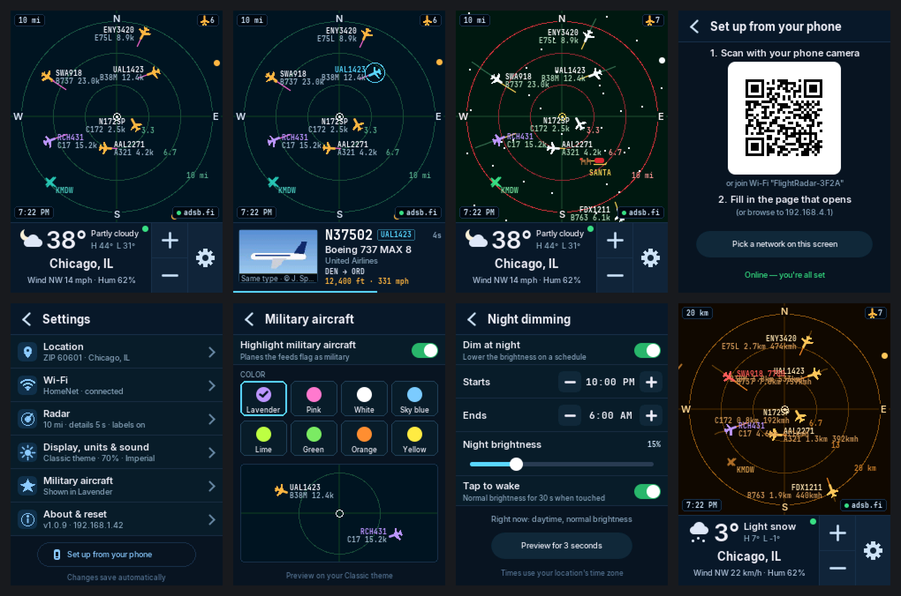

# Desk Flight Radar

**v1.0.12** · firmware for the **Waveshare ESP32-C6-Touch-LCD-2.8**

A live aircraft radar for your desk. The top of the 2.8" screen is a 43.2 × 43.2 mm square radar
(exactly 240 × 240 px) showing the planes around you, dead-reckoned between updates so they move
smoothly. Below it is a strip with the local weather, zoom buttons and a settings gear. Tap any
plane to see its photo, tail number, type, airline and route.



## Start here

| I want to… | Read |
|---|---|
| Flash boards | [docs/FLASHING.md](docs/FLASHING.md) · file: [`release/FlightRadar-v1.0.12.bin`](release/) at `0x0` |
| Prepare gifts (test, reset, pack) | [docs/PRODUCTION_CHECKLIST.md](docs/PRODUCTION_CHECKLIST.md) |
| Print the card for the box | [docs/QuickStart-Card.pdf](docs/QuickStart-Card.pdf) (5 × 7 in, two-sided) |
| Set up and use the radar | [docs/USER_GUIDE.md](docs/USER_GUIDE.md) |
| Build or change the firmware | [docs/DEVELOPER_GUIDE.md](docs/DEVELOPER_GUIDE.md) |
| Look up pins and chips | [docs/HARDWARE.md](docs/HARDWARE.md) |
| See what changed | [CHANGELOG.md](CHANGELOG.md) |
| Check licenses and data sources | [THIRD_PARTY_NOTICES.md](THIRD_PARTY_NOTICES.md) |

## Features

- **Square radar:** range rings, compass, speed vectors, labels toward the center, edge markers for
  distant planes, big-airport runways, optional 60-second trails, 5 zoom levels
- **Tap for details:** photo (or a labelled same-type photo), tail number, type, airline/owner,
  route, altitude and speed. Nearby planes are looked up ahead of time, so most taps are instant.
- **Weather strip:** temperature, conditions, high/low, town, wind and humidity, with a
  status dot
- **Easy setup:** scan a QR code with a phone, or pick the network and type the password on the
  screen. ZIP code or latitude/longitude.
- **Highlights:** military aircraft (choice of 8 colors), emergency squawks in red, optional chime
  for emergencies and low overhead traffic
- **Personal:** Classic, Amber and Holiday themes, Imperial/Metric/Aviation units, 12/24-hour
  clock, scheduled night dimming down to screen-off with tap to wake, 180° rotation, and a Santa
  tracker on Christmas Eve
- **Robust:** recovers from Wi-Fi and service outages, explains wrong passwords, keeps settings
  across firmware updates, hold BOOT 5 s to reset

## Package contents

```
release/               FlightRadar-v1.0.12.bin (flash at 0x0) and SHA256SUMS.txt
docs/                  guides, QuickStart-Card.pdf, screens/ (rendered from the real UI code)
src/                   firmware source (C++, Arduino-ESP32 + LovyanGFX)
fonts/                 Inter and JetBrains Mono TTFs used to generate src/fonts_data.h
tools/make_fonts.py    regenerates the fonts
tools/make_card.py     regenerates the quick-start card
tools/simulator/       renders every screen on Linux without a board
tools/jpeg_test/       tests for the photo decoder (src/jpeg_small.cpp)
third_party/           license texts
platformio.ini         build configuration
```

## Build

```sh
pip install platformio
pio run               # build -> .pio/build/radar/firmware.factory.bin
pio run -t upload     # flash over USB
```

Details in [docs/DEVELOPER_GUIDE.md](docs/DEVELOPER_GUIDE.md).

## Credits

Aircraft data: [adsb.fi](https://adsb.fi), [airplanes.live](https://airplanes.live),
[adsb.lol](https://adsb.lol) · Weather: [Open-Meteo.com](https://open-meteo.com) (CC BY 4.0) ·
Photos: [planespotters.net](https://www.planespotters.net), [airport-data.com](https://www.airport-data.com) ·
Aircraft and routes: [adsbdb.com](https://www.adsbdb.com) · ZIP lookup:
[zippopotam.us](https://zippopotam.us) · Runways: [OurAirports](https://ourairports.com).
Inspired by [MatixYo/ESp32-Plane-Radar](https://github.com/MatixYo/ESp32-Plane-Radar).
The aircraft data services are free for personal, non-commercial use.
