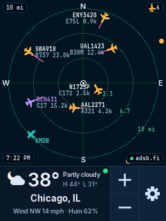
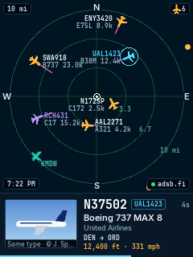
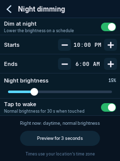

# Desk Flight Radar: user guide

Your Desk Flight Radar shows the aircraft flying around you right now, live, on a little
square radar scope, with the local weather underneath. Tap any plane to see what it is.

---

## 1. Getting started

1. **Power it** from any USB-C phone charger or computer port.
2. The screen shows **Welcome to Flight Radar** and a QR code.
3. **Connect it to your Wi-Fi.** Pick whichever is easier:
   - **With your phone:** scan the QR code with the camera app. Your phone joins the radar's
     own setup hotspot (named `FlightRadar-` plus four characters) and a setup page opens.
     Enter your home Wi-Fi name and password, plus your **US ZIP code** (or a latitude and
     longitude), then tap **Save & connect**. If the page doesn't open by itself, browse to
     **http://192.168.4.1**.
   - **On the radar itself:** tap **Pick a network on this screen**, choose your network and
     type the password on the on-screen keyboard. Once it's online, the radar asks for your
     ZIP code.
4. Planes appear a few seconds after it's online. Put your phone back on your normal Wi-Fi.
   The setup hotspot switches itself off.

> **Wi-Fi notes:** only **2.4 GHz** networks work (most home routers offer both 2.4 and 5 GHz).
> Guest Wi-Fi that needs a sign-in web page (hotels, some offices) isn't supported.

---

## 2. The screen

The top square is the radar: **you are in the middle**, north is up, and the outer ring is the
range shown in the top-left corner. Planes beyond the ring but inside the square are still
shown; planes farther away appear as dots on the edge, in their direction.

| What you see | What it means |
|---|---|
| Plane icon | Points the way the plane is flying |
| Pink line from the nose | Speed: longer = faster |
| Label | Callsign, then type and altitude (e.g. `B38M 12.4k` = Boeing 737 MAX 8 at 12,400 ft) |
| **Amber** plane | Normal traffic |
| **Lavender** plane | Military aircraft (color can be changed in Settings) |
| **Red** plane | Emergency squawk (7500 / 7600 / 7700) |
| **Cyan** plane | The one you tapped |
| Teal crosses | Runways of major airports nearby |
| Top-left | Range |
| Top-right | Planes inside the square |
| Bottom-left | Local time |
| Bottom-right | Data status: green dot + source name = live. Tap it when it says "No Wi-Fi" or "Wi-Fi?" |

**The bottom strip** shows the weather: temperature, conditions, today's high and low, your
town, wind and humidity. The small dot at its top right is the weather status: green = up to
date, amber = loading, red = the weather service isn't answering (it keeps retrying). Tap the
weather to refresh it.

**+ and −** zoom in and out (3, 5, 10, 25 or 50 miles). **The gear** opens Settings.

### Tap a plane

The weather is replaced for a few seconds by the plane's photo, tail number, aircraft type,
airline or owner, route and current altitude and speed. A bar at the bottom counts down. Tap
the strip to close it early.

- The text for nearby planes usually shows instantly, because the radar looks it up ahead of
  time. The photo is fetched when you tap, so it takes a second or two.
- If the photo says **"Same type"**, it's a stock photo of the same model, not that exact
  aircraft.
- Small private planes often have no photo or route on file. That's normal.
- **"Photo failed"** means the photo couldn't be downloaded just then (busy server, weak Wi-Fi).
  Tap the plane again to retry. **"No photo"** means there's none on file for that aircraft.

---

## 3. Settings

Tap the **gear**. Changes save automatically.

| Menu | What's in it |
|---|---|
| **Location** | US ZIP code, or latitude / longitude. The radar is centered here. |
| **Wi-Fi** | Nearby networks, join a hidden network, or set up from your phone. Shows "Wrong password" if the router refuses the password; tap the network to retype it. |
| **Radar** | How long tapped details stay up (3–30 s) · start-up zoom · which labels to show (callsign, type, altitude, speed) · hide planes on the ground · airport runways · 60-second flight trails · altitude filter (all, below or above 10,000 ft) · data source (adsb.fi, airplanes.live or adsb.lol) |
| **Display, units & sound** | Brightness · units (Imperial, Metric, Aviation) · theme (Classic, Amber, Holiday) · 12/24-hour clock · Night dimming · rotate the screen 180° · alert chime · Santa tracker |
| **Military aircraft** | Turn the highlight on or off and pick its color, with a live preview |
| **About & reset** | Firmware version, Wi-Fi, IP address, battery, weather status, credits, Restart, Factory reset |

### Night dimming

Dims the screen on a schedule (default 10 PM to 6 AM at 15%).

- **Starts / Ends:** tap − and + to move in 30-minute steps.
- **Night brightness:** from 60% down to **Screen off**.
- **Tap to wake:** at night, a touch brings back normal brightness for 30 seconds. If the screen
  is fully off, the first touch only wakes it.
- **Preview for 3 seconds** shows the night brightness any time of day.

### Alert chime

When on, the radar chimes once when a plane squawks an emergency code, or when a plane passes
low overhead (within about 1.5 nautical miles and below 10,000 ft). Each plane chimes at most
once every 15 minutes.

### Santa tracker

On Christmas Eve (and until 6 AM Christmas morning) a sleigh circles the radar. Tap it for
details. Switching the setting on shows a 20-second preview.

---

## 4. Reset

To erase everything (Wi-Fi, location, settings) and get the welcome screen back:

- hold the **BOOT** button on the board for **5 seconds**, or
- **Settings → About & reset → Factory reset** (tap twice to confirm).

**Restart** in the same menu just reboots.

---

## 5. Troubleshooting

| Problem | What to do |
|---|---|
| Bottom-right says **No Wi-Fi** or **Wi-Fi?** | Tap it to open the Wi-Fi screen. Check the network is 2.4 GHz and the password is right. |
| Says **Wi-Fi password?** | The router refused the password. Tap the network and retype it. |
| Says **No location** | Settings → Location, enter your ZIP code. |
| Says **Waiting** | The aircraft service hasn't answered for 30 s. It usually recovers by itself; you can also switch the source in Settings → Radar. |
| No planes, but it says it's live | There may be no traffic nearby. Zoom out with **−**. |
| Weather dot is red | The weather service isn't answering; the radar keeps retrying. |
| Screen too bright at night | Settings → Display → Night dimming. |
| Anything else | Settings → About & reset → Restart, or unplug it for a few seconds. |

---

## 6. Privacy

The radar has no account and collects nothing about you. To work, it sends your location
(rounded to about 10 m) to the public services that supply aircraft positions (adsb.fi,
airplanes.live or adsb.lol) and weather (Open-Meteo), and your ZIP code to zippopotam.us.
When you tap a plane, its identifier is sent to adsbdb.com and planespotters.net. Wi-Fi
details are stored only on the device. The setup hotspot has no password and is only on while
you're setting up.

## 7. Credits

Aircraft data: adsb.fi, airplanes.live, adsb.lol · Weather: Open-Meteo.com (CC BY 4.0) ·
Photos: planespotters.net (photographer shown on screen), airport-data.com · Aircraft and
routes: adsbdb.com · ZIP lookup: zippopotam.us · Runways: OurAirports.
